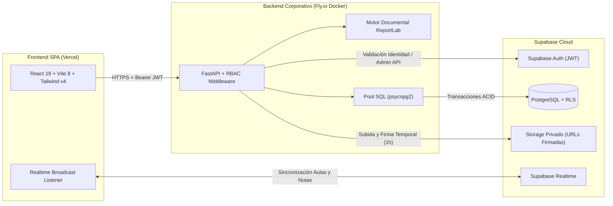

<div align="center">

# 🎓 Academia Preuniversitaria Virtual
### Plataforma Integral de Gestión Académica, Aulas Sincrónicas y Control Financiero

[](https://react.dev/)
[](https://vite.dev/)
[](https://tailwindcss.com/)
[](https://backend-proyectofinal.fly.dev/docs)
[](https://supabase.com/)
[](https://vercel.com/)

<p align="center">
  Sistema web en producción diseñado para la operación real de una <strong>Academia Preuniversitaria 100% Virtual</strong> (preparación UNMSM / UNI). Unifica la dirección institucional, el dictado sincrónico por Google Meet, la entrega calificada de evaluaciones y la facturación electrónica bajo control estricto de roles (<strong>RBAC</strong>).
</p>

[Documentación API (Swagger)](https://backend-proyectofinal.fly.dev/docs) · [Estado de Base de Datos (`/health/db`)](https://backend-proyectofinal.fly.dev/health/db) · [Repositorio Backend](https://github.com/lincoln-vega/Backend-ProyectoFinal)

</div>

---

## 📋 Tabla de Contenidos

1. [Credenciales Oficiales de Evaluación](#-credenciales-oficiales-de-evaluación)
2. [Guía de Recorrido para el Docente Evaluador](#-guía-de-recorrido-para-el-docente-evaluador)
3. [Arquitectura del Sistema](#-arquitectura-del-sistema)
4. [Módulos y Capacidades por Portal](#-módulos-y-capacidades-por-portal)
5. [Ingeniería, Seguridad y Rendimiento](#-ingeniería-seguridad-y-rendimiento)
6. [Instalación y Despliegue Local](#-instalación-y-despliegue-local)

---

## 🔐 Credenciales Oficiales de Evaluación

Todas las cuentas siguientes se encuentran **activas, verificadas en producción** y sincronizadas entre **Supabase Auth** (`auth.users`) y **PostgreSQL** (`public.users`). El docente evaluador puede ingresar directamente con cualquiera de ellas:

### 🏛️ Dirección Académica (Administrador)
| Correo Electrónico | Contraseña | Usuario Registrado | Alcance Operativo | Ruta Inicial |
| :--- | :--- | :--- | :--- | :--- |
| `admin@gmail.com` | `admin123` | Roberto Carlos Morales Salazar | Control total institucional, métricas en vivo, usuarios, horarios, nómina, caja y actas PDF | `/admin/inicio` |

### 👨‍🏫 Plana Docente (Catedráticos)
| Correo Electrónico | Contraseña | Docente Registrado | Cátedra y Ciclos Asignados | Ruta Inicial |
| :--- | :--- | :--- | :--- | :--- |
| `chavez@gmail.com` | `Chavez123` | Pedro Martlon Chavez Quispe | **Álgebra y Trigonometría** (*Semestral San Marcos 2026-II* y *Verano 2026*) | `/docente/panel` |
| `c.herrera@academia.edu.pe` | `Herrera123` | Carmen Rosa Herrera Villanueva | **Biología, Anatomía y Química DECO** (*Semestral San Marcos 2026-II*) | `/docente/panel` |
| `m.paredes@academia.edu.pe` | `Paredes123` | Miguel Ángel Paredes Ruiz | **Física General y Razonamiento Matemático** (*Anual UNI 2026*) | `/docente/panel` |
| `v.raggi@academia.edu.pe` | `Victoria123` | Victoria Angelis Raggi Ruiz | **Historia del Perú, Universal y Raz. Verbal** (*Semestral San Marcos 2026-II*) | `/docente/panel` |

### 🎓 Postulantes (Estudiantes)
| Correo Electrónico | Contraseña | Estudiante Registrado | Carrera Objetivo / Ciclos Matriculados | Ruta Inicial |
| :--- | :--- | :--- | :--- | :--- |
| `esteban@gmail.com` | `Esteban123` | Esteban Torres Mendoza | **Medicina Humana (UNMSM)** — *Semestral 2026-II (En Curso)* + *Verano 2026 (Historial)* | `/estudiante/panel` |
| `v.quispe@academia.edu.pe` | `Valeria123` | Valeria Sofía Quispe Alarcón | **Ingeniería de Sistemas (UNI)** — *Anual UNI 2026 (En Curso)* | `/estudiante/panel` |
| `anapaula@gmail.com` | `AnaPaula123` | Ana Paula Vargas Chavez | **Derecho y Ciencias Políticas (UNMSM)** — *Semestral 2026-II (En Curso)* | `/estudiante/panel` |

---

## 🧪 Guía de Recorrido para el Docente Evaluador

Para comprobar la persistencia real en la nube y la sincronización entre los tres roles en pocos minutos:

1. **Vista Ejecutiva y Emisión Documental (`admin@gmail.com` / `admin123`):**
   * Al ingresar aterrizará en el **Centro de Mando (`/admin/inicio`)** con barras porcentuales calculadas en tiempo real desde PostgreSQL, filtro interactivo de ciclos con búsqueda por escritura y la malla ejecutiva de 8 módulos.
   * En **Métricas y Reportes (`/admin/reportes`)**, genere cualquiera de las **5 Actas Oficiales en PDF** (*Récord de Notas, Kardex Individual de Alumno, Acta de Asistencia, Planilla Docente o Recaudación*) usando el visor integrado estilo *JasperViewer*.
   * En **Control de Asistencias (`/admin/incidentes`)**, previsualice los sustentos médicos PDF reales almacenados en Supabase Storage.
2. **Cátedra en Vivo y Calificación Vigesimal (`chavez@gmail.com` / `Chavez123`):**
   * En **Mis Cursos (`/docente/cursos`)**, abra una asignatura para revisar las entregas PDF enviadas por los alumnos en el previsualizador integrado y asignarles calificación (`0–20` u `Observado`) con retroalimentación individual.
   * Pulse **Iniciar Clase en Vivo** para abrir la **Cabina Docente a Pantalla Completa** (`/docente/aula-vivo/:cursoId`), equipada con cronómetro sincronizado con el servidor, pase de lista híbrido de 1 clic y subida instantánea de separatas PDF.
3. **Experiencia Multi-Ciclo del Postulante (`esteban@gmail.com` / `Esteban123`):**
   * En la barra superior cambie entre **Semestral San Marcos 2026-II** (*En Curso*) y **Verano Intensivo 2026** (*Finalizado*) para verificar cómo la plataforma activa automáticamente el **Modo Historial de Solo Lectura** sobre periodos cerrados.
   * Abra cualquier evaluación activa para previsualizar la guía del docente, subir un archivo PDF/imagen real a Supabase Storage y consultar su nota y boletas electrónicas (`/estudiante/pagos`).

---

## 🏗️ Arquitectura del Sistema



---

## 📦 Módulos y Capacidades por Portal

| Portal | Módulos Principales | Capacidades Destacadas |
| :--- | :--- | :--- |
| **Administrador** (`/admin/*`) | `Inicio General`, `Usuarios`, `Cursos`, `Horarios`, `Docentes`, `Asistencias`, `Matrículas y Pagos`, `Reportes PDF`, `Configuración` | Altas directas en Supabase Auth, detección automática de cruces horarios, aprobación de permutas/justificantes PDF, caja con emisión de boletas `B001-...` y 5 reportes oficiales PDF/Excel. |
| **Docente** (`/docente/*`) | `Mi Panel`, `Mis Cursos`, `Cabina en Vivo`, `Estudiantes`, `Horarios`, `Permutas`, `Mis Reportes PDF` | Cabina sincrónica dedicada sin distracciones, control de horas efectivas con tolerancia contractual, bandeja de revisión de tareas `0–20` y actas PDF filtradas estrictamente a su cátedra. |
| **Estudiante** (`/estudiante/*`) | `Panel Académico`, `Actividades y Entregas`, `Horarios`, `Pagos y Boletas`, `Chat Académico` | Selector global de ciclos con Modo Historial, seguimiento silencioso de permanencia en salas Google Meet, entregas individuales en Storage con previsualización local `0 ms` y descarga de comprobantes. |

---

## 🛡️ Ingeniería, Seguridad y Rendimiento

* **Seguridad Multicapa (Auth + RBAC + RLS):** Ningún cliente accede directamente a tablas sensibles; cada petición valida criptográficamente el JWT emitido por Supabase Auth y aplica autorización por rol en FastAPI junto con *Row Level Security* en PostgreSQL.
* **Buckets Privados con Firma Bajo Demanda:** Los archivos académicos y sustentos residen en buckets privados (`tareas-entregas`, `materiales-clase`, `justificantes-docentes`, `vouchers-pago`) con generación dinámica de URLs firmadas temporales para impedir enlaces caducos o filtraciones públicas.
* **Optimización de Carga (*Route Code-Splitting*):** Separación automática de *chunks* por vista mediante `React.lazy` y `Suspense`, manteniendo una carga inicial ligera y transiciones instantáneas.
* **Interfaz Adaptativa `100dvh`:** Barras laterales fijas al alto real del dispositivo, selectores inteligentes con búsqueda insensible a tildes (`SearchableSelect`) y soporte completo de modo claro/oscuro con *glassmorphism*.

---

## 💻 Instalación y Despliegue Local

### Requisitos Previos
* **Node.js** `>= 20.x` y **npm** `>= 10.x`

### Ejecución Paso a Paso

```bash
# 1. Clonar el repositorio
git clone https://github.com/lincoln-vega/Front-ProyectoFinal.git
cd Front-ProyectoFinal

# 2. Instalar dependencias
npm install

# 3. Configurar variables de entorno (.env)
cp .env.example .env
```

Variables requeridas en `.env` (y en **Vercel → Environment Variables**):

| Variable | Descripción | Valor de Referencia |
| :--- | :--- | :--- |
| `VITE_API_URL` | URL base del backend FastAPI | `https://backend-proyectofinal.fly.dev` *(o `http://127.0.0.1:8000` en local)* |
| `VITE_SUPABASE_URL` | Endpoint del proyecto Supabase | `https://hgasvotbwatoznnizmzr.supabase.co` |
| `VITE_SUPABASE_ANON_KEY` | Clave pública anónima (*Anon Key*) | Configurada en el entorno del proyecto |

```bash
# 4. Levantar entorno de desarrollo
npm run dev

# 5. Generar compilación optimizada de producción
npm run build
```

---

<div align="center">
  <sub>Desarrollado para el curso de <strong>Herramientas de Desarrollo</strong> — Arquitectura Cloud con React 19, FastAPI, Supabase, Vercel y Fly.io.</sub>
</div>
